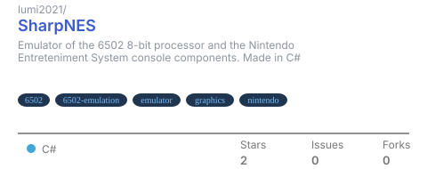
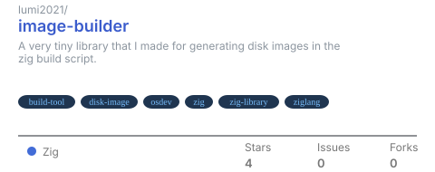
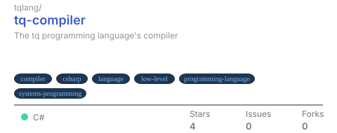
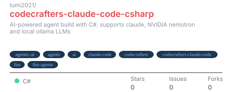
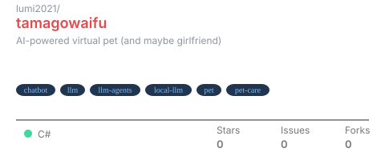
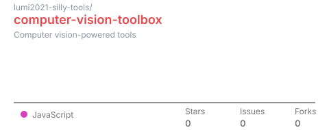
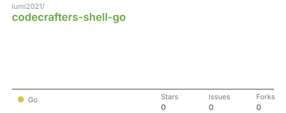
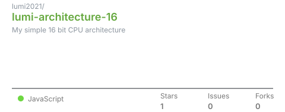
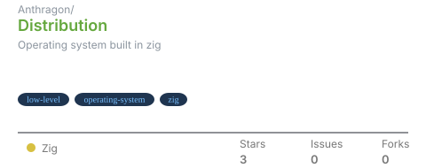
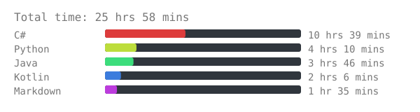

<picture>
<source media="(prefers-color-scheme: dark)" srcset="https://readme-typing-svg.herokuapp.com?width=600&height=100&center=true&vCenter=true&multiline=true&font=VT323&size=20&duration=3000&pause=300&repeat=false&lines=Welcome!%3BI%27m+Camila%2C+a+19+y+old+programming+enthusiast+%3A)&color=cfcfcf" />
<source media="(prefers-color-scheme: light)" srcset="https://readme-typing-svg.herokuapp.com?width=600&height=100&center=true&vCenter=true&multiline=true&font=VT323&size=20&duration=3000&pause=300&repeat=false&lines=Welcome!%3BI%27m+Camila%2C+a+19+y+old+programming+enthusiast+%3A)&color=000000" />

</picture>

I build software close to the machine, from programming languages and compilers to operating systems and emulators.

I'm Interested in working and experimenting with<b>computer architecture</b>,<b>systems programming</b>,<b>software engineering</b>and the technologies that make computers work.

## Please give a look on some of my best projects:

(be aware that some of those may be still in development)

### Recent work:

### AI-related:

### Experiments and miscelaneous:

## About Me

- 🌱 I'm breathing
- 😄 Pronouns: She / Her

### Stack:

  \

  \
 
 
 
 
 

### Tools and editors:

<!--  -->

### Github activity:

- ✏️ Made 65 commits
- ✏️ Made 12 commits
- ✏️ Made 8 commits
- ✏️ Made 8 commits
- ✏️ Made 12 commits
- ✏️ Made 64 commits
- ✏️ Made 18 commits
- ✏️ Made 3 commits

### Top languages (weekly):

## Beyound the Code

A little glimpse into what I listen to and play.
All widgets in this page are updated daily and powered by
[lumi2021-silly-workflows/markdown-plus](https://github.com/lumi2021-silly-workflows/markdown-plus).

### Songs I like

<a href="https://www.last.fm/music/Jamie+Paige/_/Machine+Love">
</img>
</a>
 
<a href="https://www.last.fm/music/elio+mei/_/One+Man+Circus">
</img>
</a>
 
<a href="https://www.last.fm/music/Elio+Mei/_/Velcro">
</img>
</a>
 
<a href="https://www.last.fm/music/Penelope+Scott/_/Soap">
</img>
</a>
 
<a href="https://www.last.fm/music/we+are+the+dirt/_/counting+the+days">
</img>
</a>
 

### Gaming

#### Recent games

<a href="https://store.steampowered.com/app/431730" target="_blank">
<picture>
<source media="(max-width: 1061px)" width="24%" srcset="actions/cache/steam_gamecard-431730-00000000-thin_000000006afd3e22.svg" />
<source media="(min-width: 1061px)" width="49%" srcset="actions/cache/steam_gamecard-431730-00000000-wide_000000006afd3e22.svg" />

</picture>
</a>
<a href="https://store.steampowered.com/app/1353300" target="_blank">
<picture>
<source media="(max-width: 1061px)" width="24%" srcset="actions/cache/steam_gamecard-1353300-000001d3-thin_000000006afd3e22.svg" />
<source media="(min-width: 1061px)" width="49%" srcset="actions/cache/steam_gamecard-1353300-000001d3-wide_000000006afd3e22.svg" />

</picture>
</a>
<a href="https://store.steampowered.com/app/1454400" target="_blank">
<picture>
<source media="(max-width: 1061px)" width="24%" srcset="actions/cache/steam_gamecard-1454400-0000022f-thin_000000006afd3e22.svg" />
<source media="(min-width: 1061px)" width="49%" srcset="actions/cache/steam_gamecard-1454400-0000022f-wide_000000006afd3e22.svg" />

</picture>
</a>
<a href="https://store.steampowered.com/app/427520" target="_blank">
<picture>
<source media="(max-width: 1061px)" width="24%" srcset="actions/cache/steam_gamecard-427520-00000034-thin_000000006afd3e22.svg" />
<source media="(min-width: 1061px)" width="49%" srcset="actions/cache/steam_gamecard-427520-00000034-wide_000000006afd3e22.svg" />

</picture>
</a>

<i>Disclaimer: All game titles, arts, logos, and trademarks belong to Steam (Valve Corporation) and their respective developers.</i>

#### Perfected games

<a href="https://store.steampowered.com/app/1289310" target="_blank">
<picture>
<source media="(max-width: 1061px)" width="24%" srcset="actions/cache/steam_gamecard-1289310-0000000a-thin_000000006afd3e22.svg" />
<source media="(min-width: 1061px)" width="49%" srcset="actions/cache/steam_gamecard-1289310-0000000a-wide_000000006afd3e22.svg" />

</picture>
</a>
<a href="https://store.steampowered.com/app/433340" target="_blank">
<picture>
<source media="(max-width: 1061px)" width="24%" srcset="actions/cache/steam_gamecard-433340-00000039-thin_000000006afd3e22.svg" />
<source media="(min-width: 1061px)" width="49%" srcset="actions/cache/steam_gamecard-433340-00000039-wide_000000006afd3e22.svg" />

</picture>
</a>
<a href="https://store.steampowered.com/app/255520" target="_blank">
<picture>
<source media="(max-width: 1061px)" width="24%" srcset="actions/cache/steam_gamecard-255520-00000002-thin_000000006afd3e22.svg" />
<source media="(min-width: 1061px)" width="49%" srcset="actions/cache/steam_gamecard-255520-00000002-wide_000000006afd3e22.svg" />

</picture>
</a>
<a href="https://store.steampowered.com/app/1997680" target="_blank">
<picture>
<source media="(max-width: 1061px)" width="24%" srcset="actions/cache/steam_gamecard-1997680-0000003a-thin_000000006afd3e22.svg" />
<source media="(min-width: 1061px)" width="49%" srcset="actions/cache/steam_gamecard-1997680-0000003a-wide_000000006afd3e22.svg" />

</picture>
</a>

<i>Disclaimer: All game titles, arts, logos, and trademarks belong to Steam (Valve Corporation) and their respective developers.</i>

Support my work, buy me a coffee!  \

