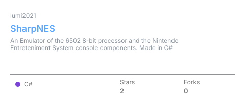
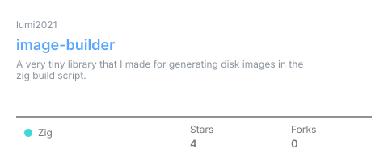
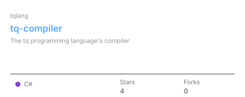
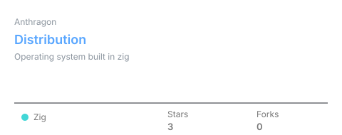
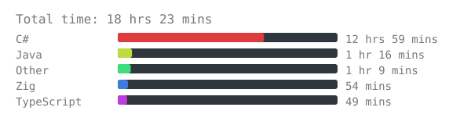

<picture>
<source media="(prefers-color-scheme: dark)" srcset="https://readme-typing-svg.herokuapp.com?width=600&height=100&center=true&vCenter=true&multiline=true&font=VT323&size=20&duration=3000&pause=300&repeat=false&lines=Welcome!%3BI%27m+Camila%2C+a+19+y+old+programming+enthusiast%3BI+write+code+%3A)&color=cfcfcf" />
<source media="(prefers-color-scheme: light)" srcset="https://readme-typing-svg.herokuapp.com?width=600&height=100&center=true&vCenter=true&multiline=true&font=VT323&size=20&duration=3000&pause=300&repeat=false&lines=Welcome!%3BI%27m+Camila%2C+a+19+y+old+programming+enthusiast%3BI+write+code+%3A)&color=000000" />

</picture>

## Please give a look on my last projects:

## Randomness About Me

- 🔭 Currently working on a [compiler](https://github.com/tqlang/tq-compiler) and an [operating system](https://github.com/Anthragon/Distribution)
- 🌱 Breathing
- 📫 Talk with me in my Discord DM ([@lumi_nya](https://discordapp.com/users/632992487375634432))
- 😄 Pronouns: She / Her

<!--  -->

## My Activity

- ✏️ Made 3 commits
- ✏️ Made 9 commits
- ✏️ Made 6 commits
- ✏️ Made 8 commits
- ✏️ Made 19 commits
- ✏️ Made 3 commits
- ✏️ Made 4 commits
- ✏️ Made 1 commit
- ✏️ Made 47 commits
- ✏️ Made 3 commits

Support my work, buy me a coffee!  \

## Songs I like

<a href="https://www.last.fm/music/Jamie+Paige/_/Machine+Love">
</img>
</a>
<a href="https://www.last.fm/music/elio+mei/_/One+Man+Circus">
</img>
</a>
<a href="https://www.last.fm/music/we+are+the+dirt/_/counting+the+days">
</img>
</a>
<a href="https://www.last.fm/music/Elio+Mei/_/Velcro">
</img>
</a>
<a href="https://www.last.fm/music/Elio+Mei/_/Playing+Dead">
</img>
</a>

## Socials

### Gaming

### Recent games

<a href="https://store.steampowered.com/app/1353300" target="_blank">
<picture>
<source media="(max-width: 1061px)" width="24%" srcset="actions/cache/steam_gamecard-1353300-000001ca-thin_000000006ae2d131.svg" />
<source media="(min-width: 1061px)" width="49%" srcset="actions/cache/steam_gamecard-1353300-000001ca-wide_000000006ae2d131.svg" />

</picture>
</a>
<a href="https://store.steampowered.com/app/1919460" target="_blank">
<picture>
<source media="(max-width: 1061px)" width="24%" srcset="actions/cache/steam_gamecard-1919460-00000001-thin_000000006ae2d131.svg" />
<source media="(min-width: 1061px)" width="49%" srcset="actions/cache/steam_gamecard-1919460-00000001-wide_000000006ae2d131.svg" />

</picture>
</a>
<a href="https://store.steampowered.com/app/1454400" target="_blank">
<picture>
<source media="(max-width: 1061px)" width="24%" srcset="actions/cache/steam_gamecard-1454400-0000022e-thin_000000006ae2d131.svg" />
<source media="(min-width: 1061px)" width="49%" srcset="actions/cache/steam_gamecard-1454400-0000022e-wide_000000006ae2d131.svg" />

</picture>
</a>
<a href="https://store.steampowered.com/app/433340" target="_blank">
<picture>
<source media="(max-width: 1061px)" width="24%" srcset="actions/cache/steam_gamecard-433340-00000039-thin_000000006ae2d131.svg" />
<source media="(min-width: 1061px)" width="49%" srcset="actions/cache/steam_gamecard-433340-00000039-wide_000000006ae2d131.svg" />

</picture>
</a>

<i>Disclaimer: All game titles, arts, logos, and trademarks belong to Steam (Valve Corporation) and their respective developers.</i>

### Perfected games

<a href="https://store.steampowered.com/app/1289310" target="_blank">
<picture>
<source media="(max-width: 1061px)" width="24%" srcset="actions/cache/steam_gamecard-1289310-0000000a-thin_000000006ae2d131.svg" />
<source media="(min-width: 1061px)" width="49%" srcset="actions/cache/steam_gamecard-1289310-0000000a-wide_000000006ae2d131.svg" />

</picture>
</a>
<a href="https://store.steampowered.com/app/433340" target="_blank">
<picture>
<source media="(max-width: 1061px)" width="24%" srcset="actions/cache/steam_gamecard-433340-00000039-thin_000000006ae2d131.svg" />
<source media="(min-width: 1061px)" width="49%" srcset="actions/cache/steam_gamecard-433340-00000039-wide_000000006ae2d131.svg" />

</picture>
</a>
<a href="https://store.steampowered.com/app/255520" target="_blank">
<picture>
<source media="(max-width: 1061px)" width="24%" srcset="actions/cache/steam_gamecard-255520-00000002-thin_000000006ae2d131.svg" />
<source media="(min-width: 1061px)" width="49%" srcset="actions/cache/steam_gamecard-255520-00000002-wide_000000006ae2d131.svg" />

</picture>
</a>
<a href="https://store.steampowered.com/app/1997680" target="_blank">
<picture>
<source media="(max-width: 1061px)" width="24%" srcset="actions/cache/steam_gamecard-1997680-0000003a-thin_000000006ae2d131.svg" />
<source media="(min-width: 1061px)" width="49%" srcset="actions/cache/steam_gamecard-1997680-0000003a-wide_000000006ae2d131.svg" />

</picture>
</a>

<i>Disclaimer: All game titles, arts, logos, and trademarks belong to Steam (Valve Corporation) and their respective developers.</i>

> Thanks for read :p
